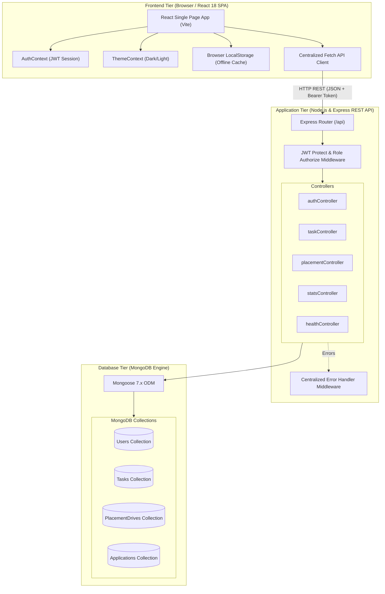
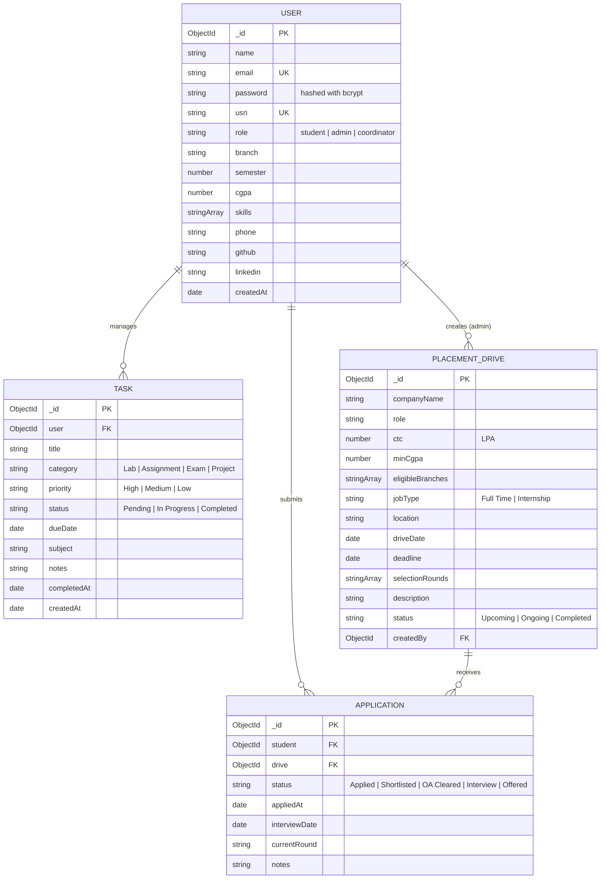
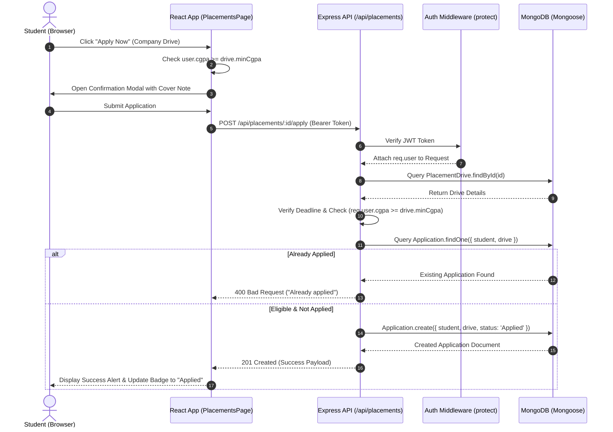
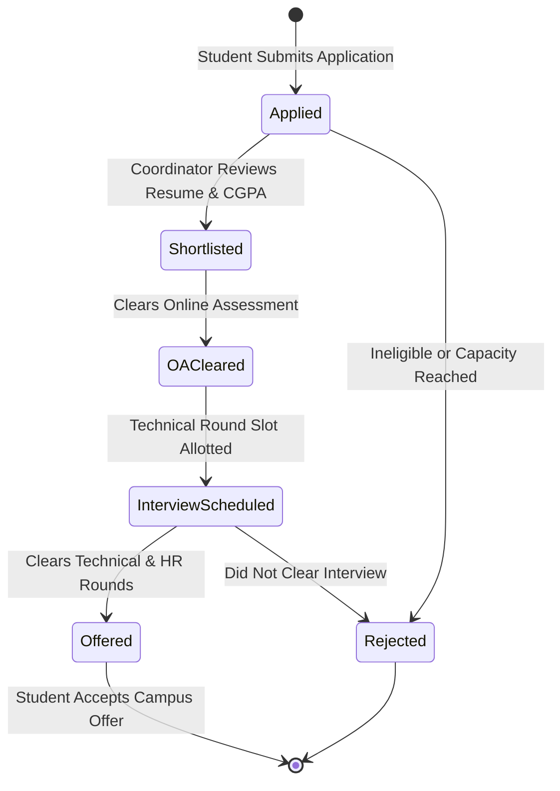

# EduPulse Architectural Design & Component Models

This document details the software architecture, data flow pipelines, component hierarchy, and database entity relationships for the **EduPulse** full-stack application.

---

## 1. System Architecture Flowchart

---

## 2. Database Entity-Relationship Diagram (ERD)

---

## 3. Sequence Diagram: Student Placement Application Workflow

---

## 4. State Diagram: Application Lifecycle

---

## 5. Directory Structure & Separation of Concerns

- **`client/`**: Pure presentation and client-side routing. Vite abstracts the build process, while CSS variables establish consistent styling. React Context isolates authorization and theme state from visual components.
- **`server/`**: Pure stateless RESTful API. Express mounts routers which delegate business operations to dedicated controllers. Mongoose models validate business invariants before committing to MongoDB. Centralized error handling catches all exceptions.
- **`postman/`**: Pre-configured test suites for independent API verification.
- **`docs/`**: Academic reports, syllabus mapping, viva notes, and deployment manuals.
